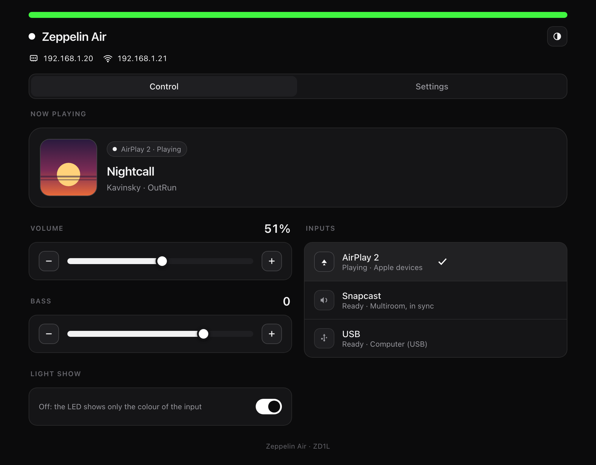
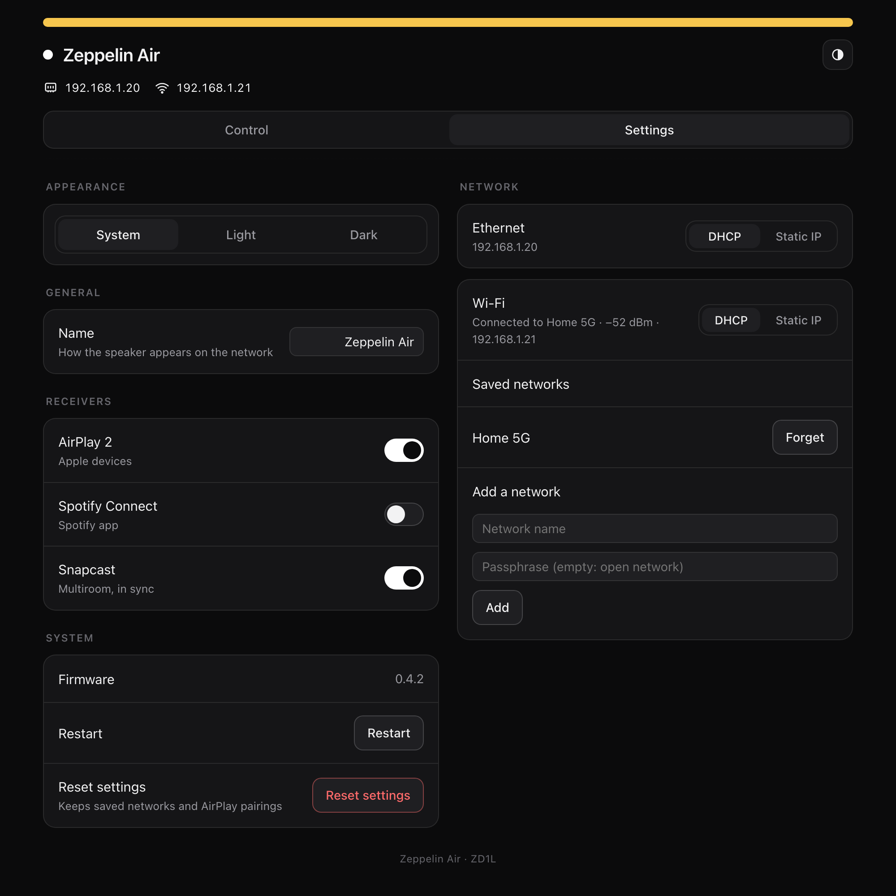

# Zeppelin Air with Lightning (ZD1L): custom firmware

Custom firmware for the **Bowers & Wilkins Zeppelin Air with Lightning connector** (ZD1L, 2013), developed on one real
speaker. It is a fork of [`pawlowskialex/zd1`](https://github.com/pawlowskialex/zd1), whose AirPlay 2 / Snapcast
firmware for the 30-pin Zeppelin Air it builds on; the Lightning support itself is the maintainer's
([PR #5](https://github.com/pawlowskialex/zd1/pull/5)), and this fork adds what is described below.

**The goal:** a Lightning Zeppelin Air that is a good network speaker today: AirPlay 2, USB and analog AUX, and a
control panel you open in any browser, **all installed over the Ethernet port**. The Lightning model's MCU bootloader
opens no USB DFU, so the only way in is the module's BL2 web updater on a wired link; nothing has to be opened,
soldered or taken apart.

## The control panel

The speaker serves its own page on port 80 (`http://<speaker-ip>/`): what is playing, volume, bass, which input is in
use, the light show, and the network settings. It follows the speaker live, so a change made with the keys, in an app
or on the page shows everywhere.

**Control**



**Settings**



(Rendered from the real page with sample data; the addresses are placeholders.)

- **Control:** title, artist and cover of what AirPlay plays (when the sender provides them); volume; bass (stock's five
  presets, −3 to +1 as −/+); the inputs: AirPlay 2, Snapcast, USB and AUX, listing only what can be used now (a
  receiver that is on, USB and AUX only with a cable or plug in), and tapping one switches to it; the **light show**
  switch, which also sets the speaker's own LED: off, it shows only the input's colour.
- **Settings:** theme, the speaker's name, receivers on/off (AirPlay, Spotify Connect, Snapcast), Ethernet and Wi-Fi
  with DHCP or a static address, saved Wi-Fi networks, adding one (the passphrase is turned into the key on the
  speaker), firmware version, restart, reset.
- **No login:** the panel is plain HTTP, for a trusted home network only. `zd1.noweb` turns it off.

## Where it stands (0.4.2)

Running on the development speaker since 2026-11-18, built by CI as one `.fw` for both boards.

| | State |
|---|---|
| AirPlay 2 and 1 from iPhone and Mac, volume at stock's full range | works, checked by ear |
| Control panel: status, volume, Wi-Fi add/forget, restart, light-show switch | works, checked on the unit |
| Light show (beat-reactive LED) and its off switch | works; the LED with the show off and the setting surviving a power-cycle are not confirmed by eye yet |
| USB and AUX as inputs, picked from the panel | built, not yet confirmed on the unit |
| Bass −/+ from the panel | built, not yet confirmed on the unit |
| Title and cover from AirPlay | built; depends on what the sender sends (AirPlay 2 may send none) |
| Source switching | no more than a small pop (the mute hold is 80 ms, stock's is 500 ms) |
| **Spotify Connect** | logs in, but Spotify refuses the audio key of every track on the account it was tried with ([librespot#1649](https://github.com/librespot-org/librespot/issues/1649)); it can be turned off in the panel; Spotify plays through AirPlay meanwhile |
| **A pop at the start of playback** | seen, not yet captured or fixed |
| The iPod/Lightning dock, the IR remote, optical AUX | not supported / untested |

Version history and the details of each change: [`CHANGELOG.md`](CHANGELOG.md). The local additions to the MCU↔module
protocol (the status flags, bass and light-show commands) are listed there too; they are not in the generated spec yet.

### Versions

| Branch / tag | What it is |
|---|---|
| `release-0.4` | **the latest**: the control panel, inputs, bass, light show (0.4, 0.4.1, 0.4.2) |
| `release-0.3` | AirPlay no longer stays silent after a failed Spotify start (0.3, 0.3.1) |
| `release-0.2` | volume cap at stock's full range, version stamp (0.2, 0.2.1) |
| tag `0.1` | the baseline: the maintainer's ZD1L support + the beat-reactive light show + a first anti-pop on source switch |
| `zd1l-show` | development branch; still holds dropped experiments, so install from a release branch |

## Installing

**Read this first.** This rewrites the firmware of both boards through the module's bootloader (BL2). The tools
refuse to write the MCU's bootloader and BL2 itself, and the stock firmware can be put back the same way, but a
failure at the wrong moment could leave the speaker needing recovery
([`docs/recovery/factory-reset.md`](docs/recovery/factory-reset.md)). It has been done on one unit, by one person.
No warranty.

1. **Get the firmware.** Take the `zd1l-show-fw` artifact of the latest successful *zd1l-show* run of a release branch
   under **Actions** (it is `zd1l-show.fw`, 30 days' retention), or build it yourself with
   [nix](https://nixos.org/download/): `nix build .#zd1l-fw`; the result is `zd1l.fw` (the build needs an x86_64 Linux
   machine or builder, the MCU's compiler being an x86_64 Linux binary).
2. **Put the speaker into BL2.** Connect it to your network with an Ethernet cable. Unplug the power, hold **ON/OFF**
   while plugging it in, and wait for the white LED. The white LED alone does not prove it (the normal "AirPlay ready"
   state is also white), so check in the next step.
3. **Check that BL2 answers** (reads only, writes nothing):
   ```
   python3 -I tools/zeppelin/knos/bl2web.py <speaker-ip> zd1l-show.fw
   ```
   BL2 takes an address by DHCP (look in your router) or uses `169.254.1.1`. If something else answers on port 80, or
   nothing does, it is not in BL2: do not go on.
4. **Flash** (this writes the module and the MCU, about a minute):
   ```
   python3 -I tools/zeppelin/knos/bl2web.py <speaker-ip> zd1l-show.fw --yes
   ```
   The speaker restarts by itself. Give it a minute, then open `http://<speaker-ip>/`.
5. **Set it up** in the panel's Settings: the name, Wi-Fi if you want it.

The settings on the speaker (the name, saved networks, AirPlay pairings) survive a flash. The first writes from the
host (`zd1` command line over USB) need a press of ON/OFF on the speaker; the panel needs nothing, for it is on the
network. Back to stock: flash B&W's own `.fw` for the Lightning model the same way.

## What is in the fork, compared with upstream's ZD1L support

- **MCU (`mcu/`):** the beat-reactive light show and its switch (kept in the EEPROM), the amp muted first on a source
  switch, the volume cap at stock's 71, picking USB/AUX and setting bass from the module, a version stamp.
- **Module OS (`module/os/`):** the control panel (`zd1-webd`), AirPlay metadata and cover (`zd1-airplay`), the fix for
  AirPlay staying silent after a failed Spotify start (`zd1-audio`, `zd1-airplay`), a new Spotify device id
  (`zd1-spotify`), status, bass, light show and input commands on the link daemon (`zd1-linkd`).
- **CI:** [`.github/workflows/zd1l-show.yml`](.github/workflows/zd1l-show.yml) builds the flashable `.fw` on every push
  to a release branch.

The rest, how the hardware and the firmware work, is upstream's documentation, which still applies:
[`docs/README.md`](docs/README.md), [`docs/status.md`](docs/status.md), [`CONTRIBUTING.md`](CONTRIBUTING.md). For
the 30-pin Zeppelin Air, with the USB web installer, see [upstream's README](https://github.com/pawlowskialex/zd1#readme).

## License

Our code is MIT ([`LICENSE`](LICENSE)). Not ours and not under it: `blobs/` (B&W's, BridgeCo's and Nokia's
binaries), `re/` (material derived from the vendor firmware), and the other third-party parts listed in
[`NOTICE.md`](NOTICE.md). Not affiliated with Bowers & Wilkins, Apple or Spotify.
